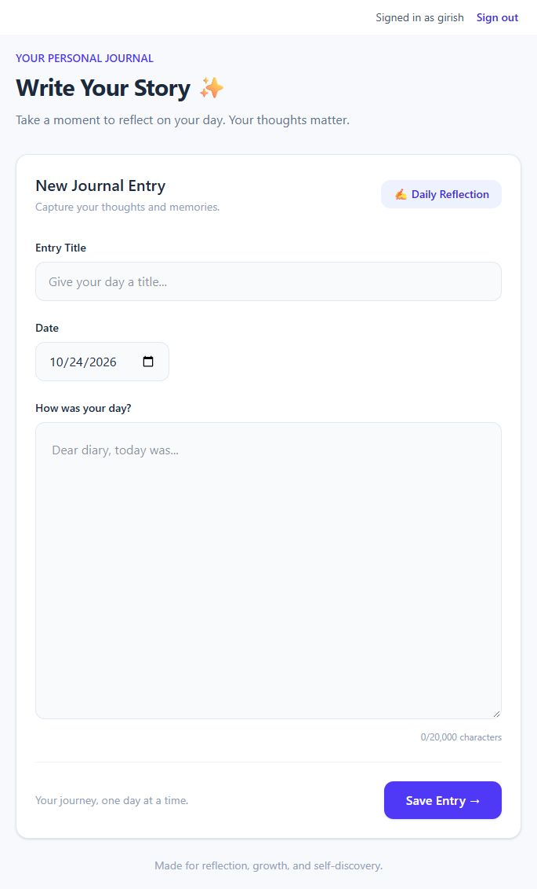
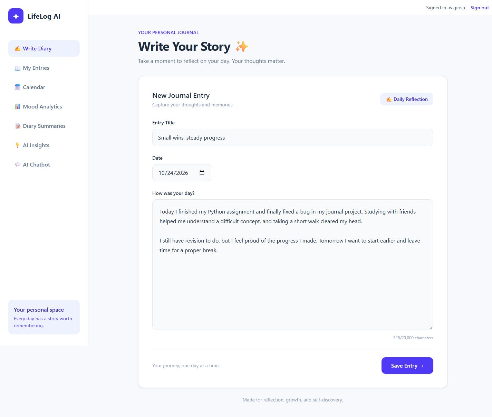
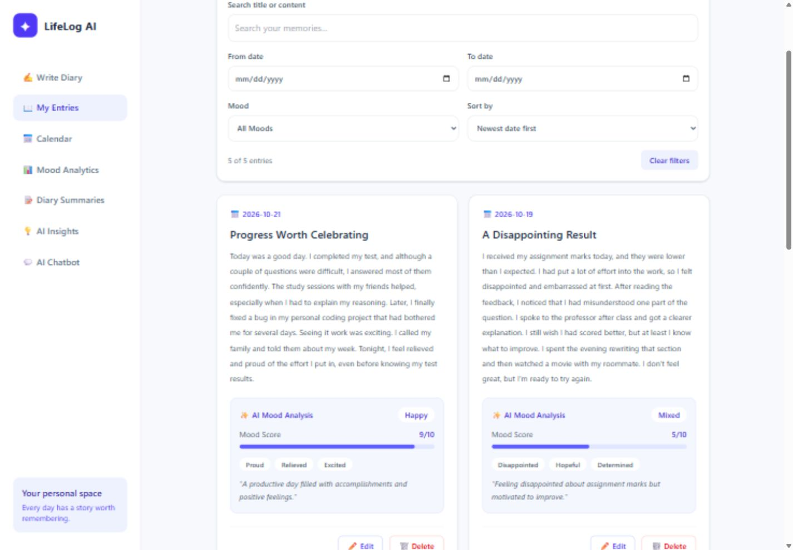
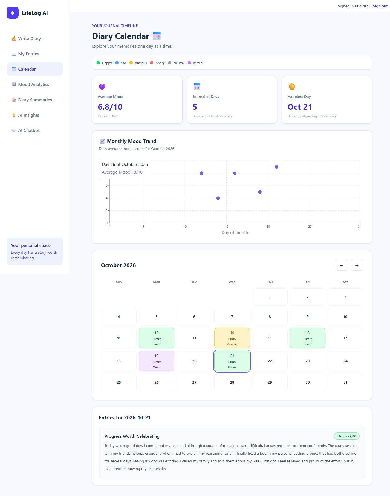
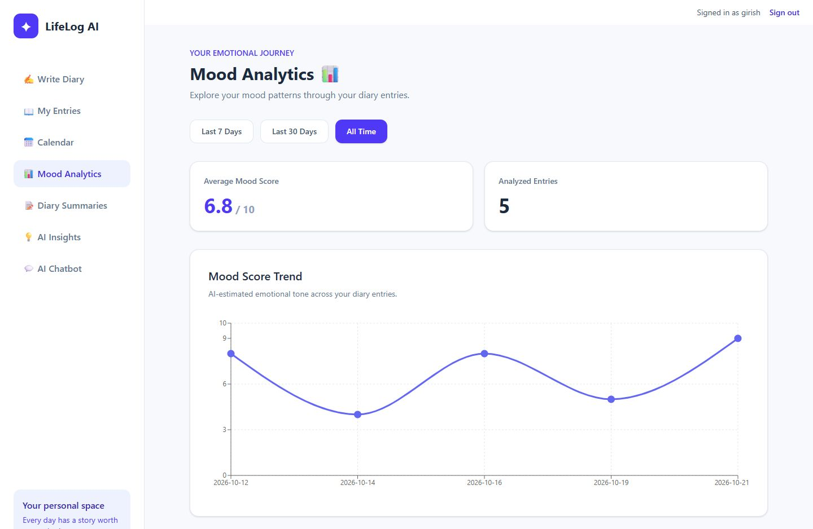
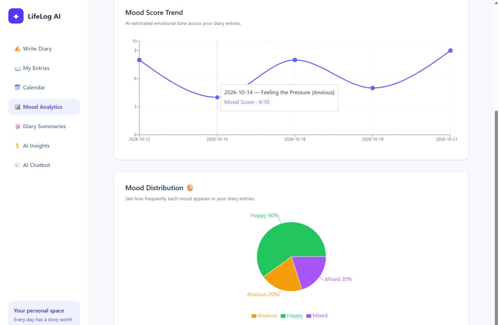
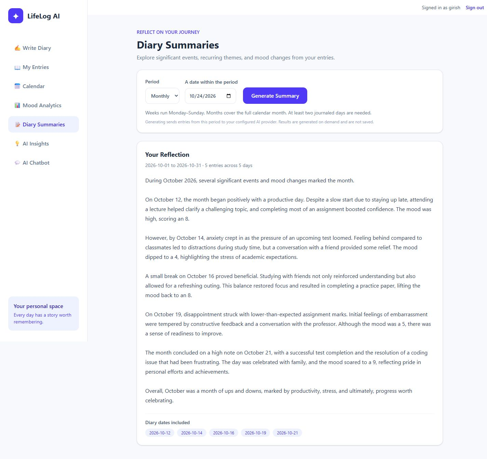
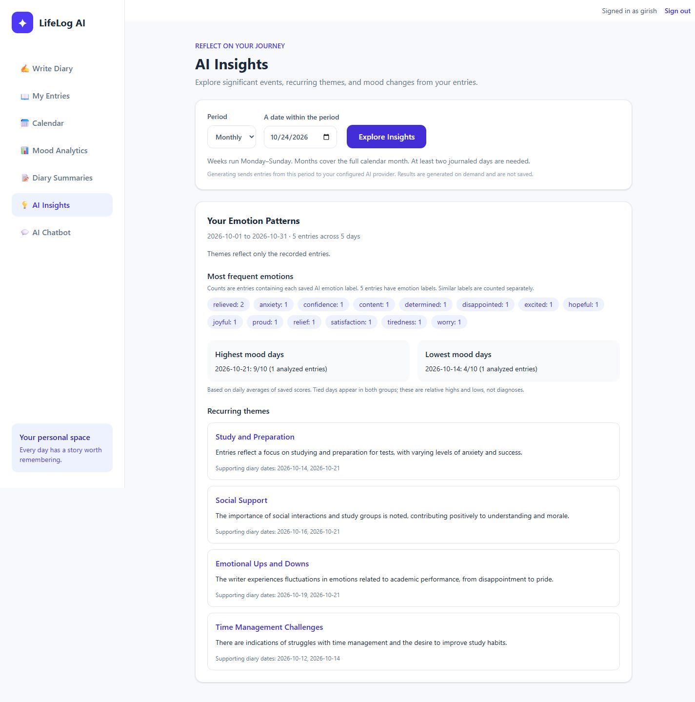
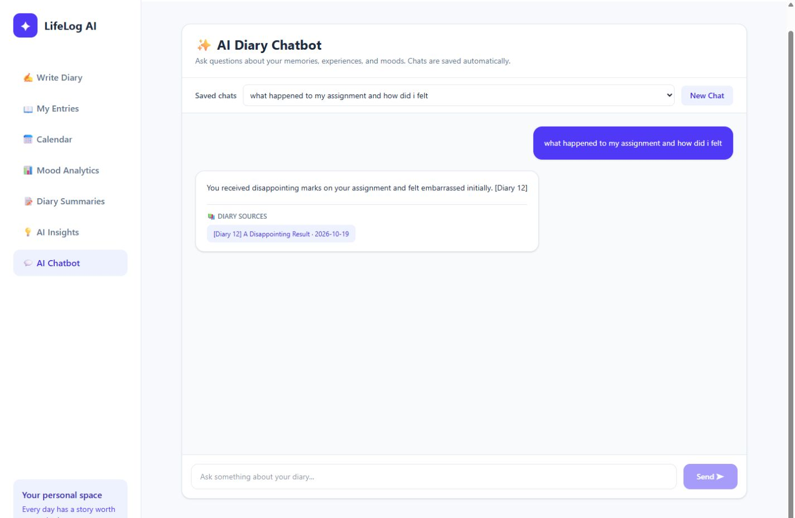
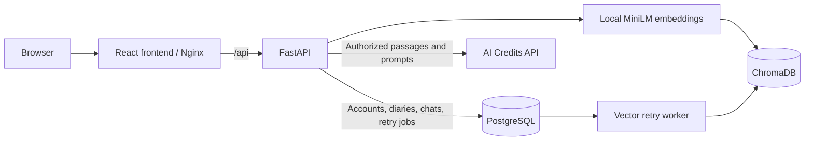

# LifeLog AI Journal

**A personal journal that turns daily reflections into searchable memories, mood trends, and AI-assisted insights.**

LifeLog AI combines a React interface, FastAPI, PostgreSQL, and retrieval-augmented generation (RAG). Write about your day, explore changes in mood, and ask questions grounded in your own diary entries.

## The problem

Writing a journal creates a useful record, but finding meaning across weeks of entries takes effort. It can be difficult to remember what contributed to a good week, locate an important experience, or notice themes across scattered notes.

LifeLog AI helps users:

- Keep dated reflections in one place.
- Find past experiences through text search and natural-language questions.
- Review estimated mood trends and frequently recorded emotions.
- Generate weekly or monthly reflections with supporting diary dates.

The goal is to support reflection and make personal memories easier to explore. AI mood labels are estimates, not a medical assessment.

## Features

- **Diary management:** create, edit, delete, search, filter, and sort entries.
- **Mood analysis:** estimated mood, a 1–10 score, emotion labels, and a short summary.
- **Calendar and analytics:** mood-colored dates, monthly statistics, daily averages, and trend charts.
- **Weekly and monthly summaries:** on-demand reflections for a selected calendar period.
- **AI insights:** emotion counts, highest/lowest daily mood averages, and recurring themes with source dates.
- **RAG chatbot:** retrieve relevant diary passages and generate answers with diary references and supporting excerpts.
- **Saved conversations:** reopen previous chats or start separate conversations.
- **Account isolation:** registration, login, logout, hashed passwords, and HttpOnly cookie sessions. Diary queries and vector retrieval are scoped to the signed-in account.
- **Reliable indexing:** a PostgreSQL outbox retains failed Chroma synchronization work for automatic retries.
- **Docker setup:** frontend, backend, and PostgreSQL with persistent data and model-cache volumes.

## Screenshots

These screenshots use fictional student journals for demonstration.

### 1. Account sign-in

Sign in to access private diary entries and conversations.



### 2. Write your story

Write a dated reflection in the journal editor.



### 3. Review and search entries

Browse fictional student journals with search, date and mood filters, and saved AI analysis.



### 4. Explore the diary calendar

Review the month, its mood trend, and entries for a selected day.



### 5. Track mood trends

Compare estimated mood scores across journaled days.



### 6. View mood distribution

See how recorded moods are distributed across the fictional entries.



### 7. Generate a monthly reflection

Read an AI-generated reflection with the diary dates included.



### 8. Explore emotion patterns and insights

Review emotion counts, high and low mood days, and recurring themes with supporting dates.



### 9. Chat with your diary

Ask about a recorded experience and review the cited diary source.



## Technology stack

| Area | Technologies |
| --- | --- |
| Frontend | React, TypeScript, Vite, Tailwind CSS |
| Charts | Recharts |
| Backend | Python, FastAPI, SQLAlchemy |
| Primary database | PostgreSQL |
| Vector index | Persistent ChromaDB |
| Embeddings | Local Sentence Transformers: `all-MiniLM-L6-v2` |
| AI integration | OpenAI-compatible SDK and LangChain |
| Configured AI provider | AI Credits, using `gpt-4o-mini` |
| Tests | Python unittest, Vitest, React Testing Library |
| Containers | Docker Compose and Nginx |

## Architecture



PostgreSQL is the source of truth. For chat, the backend checks diary ownership and any supported date scope before searching Chroma. It filters weak matches and duplicates, then asks the model to cite retrieved entries with matching supporting excerpts. Citations improve traceability; they do not guarantee that every generated interpretation is correct.

## Project structure

```text
LifeLog-AI-Journal/
├── compose.yaml                 # Local Docker stack and persistent volumes
├── .env.docker.example          # Docker configuration placeholders
├── DOCKER.md                    # Additional Docker guidance
├── backend/
│   ├── Dockerfile
│   ├── requirements.txt
│   ├── .env.example             # Native development configuration placeholders
│   ├── run_tests.py             # Runs backend suites in isolated processes
│   ├── tests/
│   └── app/
│       ├── main.py              # Diary, summary, insight, and chat API
│       ├── auth.py              # Accounts and cookie sessions
│       ├── chat_history.py      # Persistent conversations
│       ├── config.py            # Environment configuration
│       ├── database.py          # SQLAlchemy engine and sessions
│       ├── models.py            # Database models
│       ├── middleware.py        # Request-size limits
│       ├── migrations.py        # Versioned, additive migrations
│       ├── index_diaries.py     # Administrative index repair
│       ├── retry_vector_sync.py
│       └── services/
│           ├── mood_analyzer.py
│           ├── embedding_service.py
│           ├── rag_service.py
│           ├── retrieval_rules.py
│           ├── chat_service.py
│           ├── summary_service.py
│           ├── insight_service.py
│           └── vector_sync.py
└── frontend/
    ├── Dockerfile
    ├── nginx.conf               # Static frontend and /api reverse proxy
    ├── package.json
    ├── tests/
    └── src/
        ├── main.tsx
        ├── App.tsx              # Navigation and diary editor
        ├── api.ts               # API routing, cookies, and timeouts
        └── components/
            ├── AuthGate.tsx
            ├── DiaryEntries.tsx
            ├── DiaryCalendar.tsx
            ├── MoodAnalytics.tsx
            ├── DiarySummaries.tsx  # Summaries and AI insights views
            └── AIChatbot.tsx
```

Private environment files, PostgreSQL data, Chroma files, and downloaded models are not included in the repository.

## Run with Docker — recommended

### Prerequisites

- Git and a running Docker Engine with Docker Compose. On Windows, use Docker Desktop with Linux containers; enable WSL 2 and Virtual Machine Platform when required.
- An AI Credits API key for the currently configured provider. AI requests use your provider account and may incur charges; Docker does not include AI credits.
- Internet access for the first dependency build and embedding-model download. A GPU is not required.

The commands below use PowerShell. On macOS/Linux, use `cp` instead of `Copy-Item`.

### 1. Clone the repository

```powershell
git clone https://github.com/Giri0509/LifeLog-AI-Journal.git
cd LifeLog-AI-Journal
```

### 2. Create your private Docker environment file

On a fresh clone:

```powershell
Copy-Item .env.docker.example .env.docker
```

Edit `.env.docker` locally and replace the placeholders:

```dotenv
POSTGRES_USER=lifelog
POSTGRES_DB=lifelog_db
POSTGRES_PASSWORD=replace_with_a_long_random_alphanumeric_password
OPENAI_API_KEY='replace_with_your_ai_credits_key'
```

Use a long password containing letters and numbers for this Compose template, because it inserts the password directly into a database URL. The `OPENAI_API_KEY` variable name is retained for SDK compatibility; the configured endpoint is `https://aicredits.in/v1`.

Never commit `.env.docker`, `backend/.env`, or real credentials. Files ending in `.example` contain placeholders only.

### 3. Build and start

```powershell
docker compose --env-file .env.docker config --quiet
docker compose --env-file .env.docker up --build -d
docker compose --env-file .env.docker ps
```

Validation succeeds silently. PostgreSQL starts first; the backend applies migrations before serving requests; Nginx waits for backend health. The first build and model download can take several minutes.

Open **http://127.0.0.1:8080**, create an account, and write your first entry. Each new installation has an empty database. Existing Windows database accounts and diary entries are not imported automatically.

Try writing on two different dates, then generate a weekly summary or ask the chatbot a specific question about those entries. Summaries and recurring-theme analysis require at least two journaled days in the selected period.

### 4. Stop and restart

```powershell
docker compose --env-file .env.docker down
docker compose --env-file .env.docker up -d
```

Named volumes preserve PostgreSQL data, Chroma vectors, and the model cache. **Adding `-v` to `down` deletes those volumes.** Changing the database password in `.env.docker` does not update the password of an already-initialized PostgreSQL volume.

For logs:

```powershell
docker compose --env-file .env.docker logs --tail 60 backend
docker compose --env-file .env.docker logs --tail 60 frontend
```

Avoid sharing the output of `docker compose config` without `--quiet`, because resolved configuration contains credentials.

## Run locally for development — Windows

Use Python 3.12, Node.js 24, and PostgreSQL 16 for a setup aligned with the Docker configuration.

### 1. Create a PostgreSQL database

Using pgAdmin or psql, create a dedicated role and database. Replace the password placeholder locally:

```sql
CREATE USER lifelog_user WITH PASSWORD 'choose_a_strong_local_password';
CREATE DATABASE lifelog_db OWNER lifelog_user;
```

### 2. Install backend dependencies

From the repository root:

```powershell
cd backend
py -3.12 -m venv venv
.\venv\Scripts\python.exe -m pip install torch==2.14.1 --index-url https://download.pytorch.org/whl/cpu
.\venv\Scripts\python.exe -m pip install -r requirements.txt
Copy-Item .env.example .env
```

Edit `backend/.env`: set `DATABASE_URL` to your PostgreSQL database and `OPENAI_API_KEY` to your provider key. URL-encode special characters in database URL credentials. Keep the default development origins and `SESSION_COOKIE_SECURE=false` for local HTTP.

Then run:

```powershell
.\venv\Scripts\python.exe -m app.migrations
.\venv\Scripts\python.exe -m uvicorn app.main:app --reload
```

Backend: **http://localhost:8000**. API documentation: **http://localhost:8000/docs**. Diary and AI endpoints require a signed-in account.

### 3. Start the frontend

Open another terminal at the repository root:

```powershell
cd frontend
npm.cmd ci
```

Create `frontend/.env.local` containing:

```dotenv
VITE_API_BASE_URL=http://localhost:8000
```

Start Vite:

```powershell
npm.cmd run dev
```

Open **http://localhost:5173**. Restart Vite after changing its environment file. Never put API keys or database passwords in a `VITE_` variable: those values are included in browser code.

If running Docker and native development together, use `127.0.0.1:8080` for Docker and `localhost:5173` for Vite to avoid sharing session cookies between the two installations.

On macOS/Linux, use `python3.12`, `venv/bin/python`, and `npm` in place of the Windows-specific command names above.

## Tests and maintenance

Backend, from `backend/` with dependencies installed:

```powershell
.\venv\Scripts\python.exe run_tests.py
.\venv\Scripts\python.exe -m pip check
```

Frontend, from `frontend/`:

```powershell
npm.cmd test
npm.cmd run lint
npm.cmd run build
```

Automated tests use synthetic data, isolated databases, and mocked AI responses. They do not require paid AI calls or personal diary entries. Coverage includes account isolation, validation, migrations, failed vector-sync retries, retrieval/source handling, authentication screens, saved chats, and diary filtering.

Migrations are versioned and additive. Run `python -m app.migrations` before starting an updated native backend; Docker runs this command automatically on backend startup. Back up real data before upgrading.

The vector worker retries pending indexing jobs automatically. Native administrative commands, when needed:

```powershell
.\venv\Scripts\python.exe -m app.retry_vector_sync
.\venv\Scripts\python.exe -m app.index_diaries
```

The second command queues a full index repair, including orphan cleanup. Run it only when needed.

## Privacy and limitations

- Diary text is sent to the configured external AI provider for mood analysis, summaries, insights, and chatbot responses. Embeddings run locally.
- Passwords, password hashes, and session tokens are not included in AI prompts.
- The first account on an installation claims any legacy unowned entries/chats. Create it yourself before sharing access to a database containing legacy data.
- Semantic search is a selection of relevant passages, not an exhaustive analysis of every entry. Similarity thresholds may need tuning for different journals.
- PostgreSQL and Chroma are eventually consistent. A saved entry may briefly be missing from search while indexing retries.
- The supplied Compose stack binds only to the local machine and uses HTTP. Public hosting needs HTTPS, secure cookies, appropriate origins, backups, and deployment-specific security configuration.

See [Docker notes](DOCKER.md), [account setup](backend/AUTH_SETUP.md), [retrieval evaluation](backend/RAG_EVALUATION.md), and [security and testing notes](backend/SECURITY_AND_TESTING.md) for implementation details.

## Troubleshooting

| Symptom | What to check |
| --- | --- |
| Docker cannot connect to its engine | Start Docker Desktop and verify its Windows/WSL prerequisites. |
| Backend container is unhealthy | Check backend logs, database health, environment values, and migrations. |
| AI output is unavailable | Check the provider key, account credits, and outbound connectivity. Diary saves can still succeed without mood analysis. |
| Chat finds no relevant evidence | Add entries for the topic/date, allow indexing to finish, and try a more specific question. |
| Summary has insufficient data | Add entries on at least two different days within the selected week/month. |
| Native frontend cannot sign in | Check `VITE_API_BASE_URL`, use `localhost:5173`, and verify backend CORS origins. |
| Existing local entries are absent in Docker | The native and Docker installations use separate PostgreSQL databases. |

